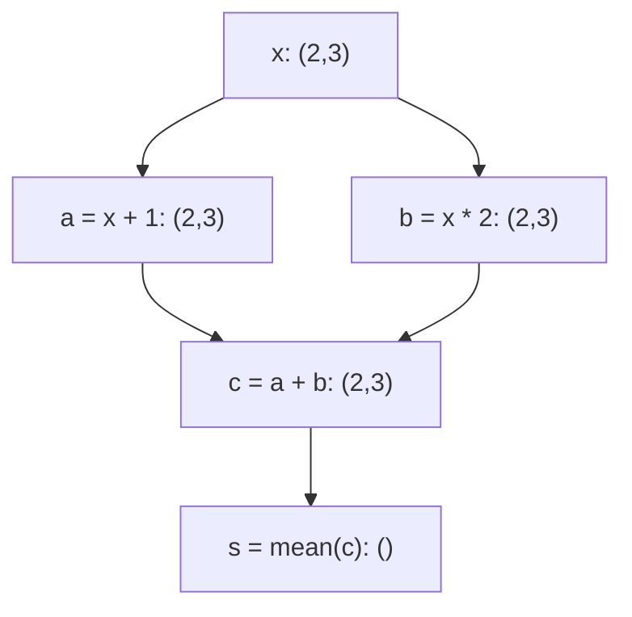

# Step 18 — MLX Execution Model

沿用既有roadmap，本轮只准备并发布 **18.2 mx.eval as an execution/materialization boundary**，初始实际修正计数 **0/2**；完成即停，不进入18.3。当前母版：[78_step18_2_eval_boundary.ipynb](../notebooks/78_step18_2_eval_boundary.ipynb)。

材料审核方已独立核验18.1真实六文件提交 `4dd066c839d8e5d371b6ba1fb9d039d50fd39efa`、固定MLX v0.32.2接口和完整教学回复，核心静态PASS、实际修正0/2。大Step16、17及18.1已通过材料保留，不返工；这是材料验收，不是学员掌握或运行反馈。18.2只登记当前初始材料编写发布，不继承前节外部验收结论。

## Step 18.1 — Lazy evaluation

母版：[77_step18_1_lazy_evaluation.ipynb](../notebooks/77_step18_1_lazy_evaluation.ipynb)。18.1真实六文件提交 `4dd066c839d8e5d371b6ba1fb9d039d50fd39efa`、固定MLX v0.32.2接口和完整教学回复已由材料审核方独立确认核心静态PASS，实际修正 **0/2**。下文保留已通过的教学及18.1当轮边界。

本节承接17.5显式求值边界，解释数组运算怎样建立计算依赖，以及为什么Python走过一行不等于对应GPU数值工作已完成。全部示例代码仅为材料，未执行、无运行输出。


### 0. 新Work Copy的依赖：只有MLX与本节常量

沿用项目 Python 3.12 / `.venv` kernel，以及 `pyproject.toml` 固定的 `mlx==0.32.2`。`import mlx.core as mx` 导入MLX数组模块，`as mx` 给它一个短名称。

新副本完整提供导入、一个2行3列的常量数组、全部中间运算，以及后文的普通Python函数。不需要旧kernel变量、`%run`旧Notebook、语料缓存、sampler、MiniGPT类、`nn.value_and_grad`或Adam对象；17.5的单步只作为已解释过的接口背景。

以后使用时，从本节导入单元开始按顺序使用即可。当前准备阶段只写这些单元，不执行它们。

```python
import mlx.core as mx

# Self-contained lesson import. All cells in this master are unexecuted.
```

### 1. Lazy Evaluation：先表达依赖，再在需要时取得数值

**Evaluation（求值）** 在这里指取得数组运算的数值结果，不是用验证集评估模型。**Lazy evaluation（惰性求值）** 允许数组运算先描述“这个结果应由哪些输入、通过什么运算产生”，在需要结果值时完成相应的数值工作。

先区分四个相互关联的东西：

| 名称 | 本节含义 |
|---|---|
| **Array object，数组对象** | Python变量可以持有的MLX对象；它可以表示已有数据，也可以表示尚待求值的运算结果 |
| **Metadata，元数据** | 描述数组的信息，例如shape和dtype，不是数组每个位置的具体值 |
| **Dependency，依赖** | 为得到一个结果，需要哪些输入数组，以及怎样对它们运算 |
| **Element values，元素数值** | 例如结果矩阵某个位置究竟是4还是7；读取这些值需要相应结果已经可用 |

看 `a = x + 1.0` 时，Python会执行右侧表达式，调用MLX的加法接口，并把返回的数组对象绑定给名字a。**Name binding（名称绑定）** 就是让变量名指向一个对象。这里调用、对象创建、shape/dtype推导、依赖记录等工作确实发生了；但返回一个数组对象，并不要求其所有元素的数值此时已经计算完成。

记录的依赖指向这次运算使用的数组对象，不是存下字符串 `x + 1.0`，以后再根据Python变量名查找输入。这个区别也解释了17.5中已建立的旧loss不会因为model后来换成新参数，就自动变为更新后的loss。

因此要分清：**Python已经处理完这次调用**，与**相应设备数值结果已经完成**。对交给GPU的数组工作，前者不能单独证明后者；有些数值工作可能尚未启动。也不能反过来把惰性求值说成“每一行都会立即异步启动一个GPU任务”。

惰性不表示整个程序什么都没做、也不表示零内存。例如从Python列表构造一个已有常量数组，需要处理这些已有数据。我们只把“记录运算关系”和“完成该运算的元素数值”区分开，不把所有MLX语句一概当作同一种行为。

固定版本依据：[v0.32.2 ops.cpp](https://github.com/ml-explore/mlx/blob/v0.32.2/mlx/ops.cpp)中的加法/乘法创建带有输入依赖的输出数组；[array.h](https://github.com/ml-explore/mlx/blob/v0.32.2/mlx/array.h)分别保存数组描述、依赖和结果可用状态。这里只用这些源码核对概念，不引入内部状态查询API。

### 2. 一个有两条分支的小例子：从矩阵到Scalar

本节的x是普通实数数组，shape为 `(2,3)`，意思是2行3列；这两个轴没有batch/token语义，x也不是MiniGPT的logits。s只是一个算术平均，不能把它叫作本节新增的语言模型loss。

先铺垫代码将用到的操作：

- `mx.array(..., dtype=mx.float32)`：从给定数据构造MLX数组，并明确使用32位浮点数。这里的嵌套Python列表每项是一行，不从外部取数据。
- **Elementwise operation（逐元素运算）**：对应位置分别运算。`x + 1.0` 给每个元素加1；`x * 2.0` 给每个元素乘2，`*`在这里不是矩阵乘法。
- **Scalar broadcasting（标量广播）**：把一个标量用于每个位置的运算。本例的shape仍为 `(2,3)`；这种数学语义不要求实际复制一整张常量矩阵。
- **Reduction（归约）**：把一组元素汇总为更少的结果。`mx.mean(c)` 在固定v0.32.2默认 `axis=None`、`keepdims=False`，对全部元素求平均且不保留被归约的维度，所以输出为scalar MLX array，shape `()`。

`None`在这个API中表示未指定某一条轴，因此使用全部轴；`False`表示不保留归约轴。本例用默认写法 `mx.mean(c)`，没有隐藏的按行平均或按列平均。

先给出明确的输入，再准备依赖关系：

```python
# EXPLICIT TOY CONSTANTS — prepared only, NOT executed.
x = mx.array(
    [[1.0, 2.0, 3.0],
     [4.0, 5.0, 6.0]],
    dtype=mx.float32,
)

# Shape (2, 3): two rows and three columns, with no token/batch meaning.
```

```python
# Build the relationships; do not display array values in this cell.
a = x + 1.0
b = x * 2.0
c = a + b
s = mx.mean(c)

# No bare array expression at the end: ordinary Notebook display can read values.
```

#### 手算的是数学结果，不是本轮的执行输出

用i表示行下标（0或1），j表示列下标（0、1或2）。例如 `x[i,j]` 指第i行第j列。上面的数学关系是：

$$
a_{ij}=x_{ij}+1,\qquad b_{ij}=2x_{ij},\qquad c_{ij}=a_{ij}+b_{ij}=3x_{ij}+1.
$$

双重求和表示把两行三列的六个位置全部相加：

$$
s=\frac{1}{6}\sum_{i=0}^{1}\sum_{j=0}^{2}c_{ij}.
$$

逐位置代入明确的x，可手算：

$$
a=\begin{bmatrix}2&3&4\\5&6&7\end{bmatrix},\qquad
b=\begin{bmatrix}2&4&6\\8&10&12\end{bmatrix},\qquad
c=\begin{bmatrix}4&7&10\\13&16&19\end{bmatrix}.
$$

$$
s=\frac{4+7+10+13+16+19}{6}=\frac{69}{6}=11.5.
$$

这些数值来自手工推导，不是运行输出，也不作为GPU完成工作的证据。代码中保留原来的两条分支，没有用手算的 `3*x+1` 偷换代码结构。

#### Compute Graph：箭头说明“依赖谁”

**Compute graph（计算图）** 是表达运算依赖关系的一种方式。图中的节点表示数组结果，箭头从输入指向依赖它的输出。本例x同时供给a与b，c需要两条分支的结果，s再汇总c：



同一关系也可直接读表；即使Notebook前端没有渲染上图，表格仍完整表达依赖：

| 结果 | 直接依赖 | 运算 | 输出shape |
|---|---|---|---|
| x | 本节已给定的常量 | 构造输入数组 | `(2,3)` |
| a | x、标量1 | 逐元素加法 | `(2,3)` |
| b | x、标量2 | 逐元素乘法 | `(2,3)` |
| c | a、b | 逐元素相加 | `(2,3)` |
| s | c | 全元素平均 | `()` |

图省略了标量常量等实现细节。它是**数学依赖示意**，不是GPU执行时间线，也不保证a与b真的并行执行。一个高级API可以由多个内部运算组成；一行Python、图中的一个逻辑节点、一个底层GPU计算任务不能简单画等号。本节不分析具体设备调度。

### 3. 为什么还没读取元素，就能知道Shape和Dtype？

**Shape（形状）** 描述各轴长度；**dtype（数据类型）** 描述元素按哪一种数值类型表示。它们属于metadata。

本例的shape可以沿规则推出：x已知为 `(2,3)`；标量广播不改变a/b的shape；同shape的a与b相加得到同shape的c；对全部六个元素求平均并移除归约轴，s就没有剩余轴。这个推理不需要先读出c里面的4、7、10等结果。

Python中的 **attribute（属性）** 用点号读取：`c.shape`、`c.dtype`，这两处不加括号。固定MLX版本把shape暴露为Python tuple，把dtype暴露为数据类型描述；这两个读取本身不要求c的元素值完成求值。`print(...)` 是Python的显示函数；下面传给它的是标签字符串、shape tuple和dtype，而不是MLX数组本身。

本例x/a/b/c的shape均为 `(2,3)`，s为 `()`，这些数组的dtype为float32。**`()`表示零个轴的标量数组，仍有一个元素，不是空数组，也不是已经转换好的Python float。** 已经能读取这个shape，不能推出该标量的值已经完成计算。

固定依据：[v0.32.2 array.h](https://github.com/ml-explore/mlx/blob/v0.32.2/mlx/array.h)的shape/dtype访问器，以及[Python array binding](https://github.com/ml-explore/mlx/blob/v0.32.2/python/src/array.cpp)。

```python
# Metadata access only. This cell has not been executed.
print("x metadata:", x.shape, x.dtype)
print("a metadata:", a.shape, a.dtype)
print("b metadata:", b.shape, b.dtype)
print("c metadata:", c.shape, c.dtype)
print("s metadata:", s.shape, s.dtype)

# These attributes describe results; they are not evidence of numerical completion.
```

### 4. 普通Python函数已经返回，也不自动证明数值完成

这与17.5使用普通Python函数并不矛盾。先恢复三个Python含义：

- `def build_score(arr):` 定义一个函数；定义时不会执行函数体。`arr`是形参，调用时接收传入的数组对象。
- `build_score(x)` 才是调用，Python会执行函数体中的语句。名字 `build_score` 是本节自定义名称，不是一个额外的MLX API。
- `return score` 把score所指的对象交还给调用者。本例返回MLX数组对象，不在return处自动把它转成Python数字。

下面只是把同一个两分支表达式放进普通函数。`left`、`right`、`combined`、`score`是函数内部的变量名，分别对应之前的a、b、c、s；传入同一个x，数学关系和shape不变。函数返回后，调用者将该数组对象绑定给 `score_from_function`。

在这个只用数组运算并返回数组的函数中，**函数体执行结束**与**结果元素的数值完成**仍是两件事。普通Python的return不是额外的求值请求。本例没有任何编译包装，也没有训练步骤。

```python
def build_score(arr):
    left = arr + 1.0
    right = arr * 2.0
    combined = left + right
    score = mx.mean(combined)
    return score


# One prepared ordinary function call; NOT executed during material preparation.
score_from_function = build_score(x)
print("returned metadata:", score_from_function.shape, score_from_function.dtype)

# Returning an MLX array does not itself request its element value.
```

### 5. 看描述与读取值不同：接回17.5的求值边界

有些操作需要真正的元素值。**Implicit evaluation（隐式求值）** 指代码没有单独写 `mx.eval`，但某个取值操作为了给出结果而要求数组求值。这里仅辨认最常见的显示/取值方式，不增加求值或性能实验。

| 阅读到的表达式 | 要取得什么 | 与本例求值的关系 |
|---|---|---|
| `s.shape`、`s.dtype` | 结果的描述 | 这两个属性访问本身不要求元素值 |
| `print(s)` | 数组的数值表示 | 会要求s完成相应求值，才能显示值 |
| Notebook单元末尾的裸表达式 `s` | 常规交互显示中的对象表示 | 通常也会读取数组数值；不能把它视为纯metadata检查 |
| `s.item()` | 单个元素转为标准Python scalar | 需要时会求值；本例float32标量会转为Python float |
| `mx.eval(s)` | 明确要求s及所需依赖完成 | 沿用17.5接口，返回None，不返回一个新s |

`array.item()`是数组对象上的 **method（方法）**，所以有括号；固定版本要求数组只有一个元素。本例s满足条件。这个接口已经在17.5日志显示中出现，这里只是说明它为什么不能当作不影响求值的“查看一下”。

这也解释了前面代码为什么只打印 `.shape`、`.dtype`，并避免把MLX数组单独留在单元格最后一行。以后看到数组已经被打印，不能据此反推“之前每个加法语句都立即完成了数值计算”；打印本身可能正是要求数值的操作。

上述表格是接口阅读材料，不是本节额外的执行单元。固定版本中，数组的数值显示路径会调用求值，见[Python array binding](https://github.com/ml-explore/mlx/blob/v0.32.2/python/src/array.cpp)与[utils.cpp](https://github.com/ml-explore/mlx/blob/v0.32.2/mlx/utils.cpp)；`.item()`的取值路径见[convert.cpp](https://github.com/ml-explore/mlx/blob/v0.32.2/python/src/convert.cpp)。

#### 17.5的边界现在更容易理解

17.5的 `loss_and_grad_fn(model, X, Y)` 建立forward、scalar loss和梯度的关系；`optimizer.update(model, grads)`继续用梯度建立新参数与新状态的关系，并把对象中的引用更新好。仅从这两次Python调用已经返回，不能推出所有相应的设备数值已经完成。

所以17.5接着使用 `mx.eval(loss_before_update, model.parameters(), optimizer.state)`，明确要求这些结果及其依赖完成。这个接口等待指定结果可用后返回None；它不是对所有无关GPU工作的全局完成承诺。

那一节的训练函数之所以在返回前有明确的完成要求，是因为它**在函数体中写了求值边界**，不是因为普通Python函数的return天然具有这种保证。18.1只解释这个原因，不重建模型、优化器或训练单步，也不展开18.2的边界安排、图增长和内存主题。

### 本节的工作副本顺序、材料状态与停止点

以后使用本节新work副本时：

1. 在仓库根目录先 `git pull`，再将77母版用时间戳新文件名及 `cp -n` 安全复制到已有 `notebooks/work/`；只打开新副本。
2. 选择项目Python3.12 / `.venv` kernel，从本节 `import mlx.core as mx` 开始；其后输入常量和全部定义都已在副本中。
3. 按次序阅读数组对象与依赖、常量与两分支运算、手算及shape，再使用仅读取metadata的示例；不需要先运行17.5。
4. 普通函数示例依赖的只有本节mx和x。末尾表格用于辨认取值操作，17.5边界仅作阅读衔接，不需要在77副本里补入任何model或optimizer变量。

本节贯穿的关系是：**已知数学表达式和shape，足以继续组织依赖；需要元素值时，才必须保证相应数值工作完成。** Python名称绑定、函数返回、metadata可读与GPU结果完成之间，不能仅凭其中一项替另外一项作结论。

大Step17的全部材料验收保留；18.1现已获材料审核方独立核心静态PASS，实际修正 **0/2**。18.1验收后的累计实际修正：16.1=**1/2**、16.2=**1/2**（含已记录的超时后完整回复补齐），16.3至16.5、17.1至17.5及18.1各**0/2**。每小节最多两次实际修正，跨轮与换对话不重置。

只编写发布材料，没有执行Notebook、课程代码、测试、训练、实验、采样或用户work副本，没有读取/下载语料，没有代答练习；不声称学员掌握、执行完成或运行验证通过。不返工已合格课节。

**18.1当轮完成后停在18.1，没有进入18.2。** 后续仍仅按请求逐小节准备，至大Step20全部完成后停止。

### 参考与固定版本核对

- [17.5已验收母版](https://github.com/kris0516/mlx-minigpt-from-scratch/blob/3fdec00b251765bda581c2b183e68d039c83c902/notebooks/76_step17_5_uncompiled_training_step.ipynb)：未编译单步、scalar loss与显式求值边界。
- [MLX v0.32.2 ops.cpp](https://github.com/ml-explore/mlx/blob/v0.32.2/mlx/ops.cpp)：add/multiply创建运算依赖，mean的组合实现。
- [MLX v0.32.2 array.h](https://github.com/ml-explore/mlx/blob/v0.32.2/mlx/array.h)：数组描述、shape/dtype读取，以及数值可用状态的区分。
- [MLX v0.32.2 Python ops](https://github.com/ml-explore/mlx/blob/v0.32.2/python/src/ops.cpp)与[Python array](https://github.com/ml-explore/mlx/blob/v0.32.2/python/src/array.cpp)：mean默认轴/keepdims、属性、数值显示绑定。
- [MLX v0.32.2 utils.cpp](https://github.com/ml-explore/mlx/blob/v0.32.2/mlx/utils.cpp)与[convert.cpp](https://github.com/ml-explore/mlx/blob/v0.32.2/python/src/convert.cpp)：数组显示与item读取触发相应求值。
- [MLX v0.32.2 Python transforms](https://github.com/ml-explore/mlx/blob/v0.32.2/python/src/transforms.cpp)与[core transforms](https://github.com/ml-explore/mlx/blob/v0.32.2/mlx/transforms.cpp)：仅用于复核17.5已讲过的eval接口及等待语义。
- 官方API：[array.shape](https://ml-explore.github.io/mlx/build/html/python/_autosummary/mlx.core.array.shape.html)、[mean](https://ml-explore.github.io/mlx/build/html/python/_autosummary/mlx.core.mean.html)、[array.item](https://ml-explore.github.io/mlx/build/html/python/_autosummary/mlx.core.array.item.html)。在线页面可能更新，本课程接口与行为以 **v0.32.2源码** 为准。
- [Roadmap](https://github.com/kris0516/mlx-minigpt-from-scratch/blob/main/docs/course-roadmap.md)与[teaching handoff](https://github.com/kris0516/mlx-minigpt-from-scratch/blob/main/docs/teaching-handoff.md)：18.1当前材料状态、累计计数与停止边界。


## Step 18.2 — mx.eval as an execution/materialization boundary

母版：[78_step18_2_eval_boundary.ipynb](../notebooks/78_step18_2_eval_boundary.ipynb)。本节承接18.1惰性求值及17.5单步，解释选定数组与依赖完成、迭代状态的待求值链以及内存关系。全部示例仅为材料，未执行、无输出；不进入18.3或性能实验。

### 0. 新Work Copy：导入、数据和两个迭代片段都在本节

沿用项目 Python 3.12 / `.venv` kernel，以及固定的 `mlx==0.32.2`。只用 `mlx.core`；`import ... as mx`给数组模块一个短名称。

本节重新给出18.1的常量与分支表达式，并为两个三轮状态片段分别提供明确初值。所有代码只依赖本节导入和前面的本节定义，不需要旧kernel、`%run`旧Notebook、语料、sampler、MiniGPT类、`nn`或Adam对象。

两个迭代片段用于对照阅读“求值边界放在哪里”，不是计时、内存测量或训练实验。以后使用新副本时从本节开头按顺序取得定义即可；本轮不运行这些片段。

```python
import mlx.core as mx

# Self-contained import. Every code cell in this master is unexecuted.
```

### 1. Execution/Materialization Boundary：让选定结果的数值可用

**Execution boundary（执行边界）** 在本节指一个明确的要求：选定结果所需的数值工作，要在这个调用返回前完成。**Materialization（物化）** 指让数组结果具有可读取的元素数值；数组仍是MLX数组，shape和dtype也不因这个请求而改变。

18.1已经介绍 **evaluation（求值）**：沿依赖关系取得数组数值。固定接口是：

```python
mx.eval(*args) -> None
```

这一行是接口说明，不是待运行的Python语句。`*args`表示接收多个实参；`-> None`表示不返回一个结果数组。调用时可以给一个数组、多个数组，也可以给由dict/list/tuple组成的数组树。**Array tree（数组树）** 是用这些Python容器组织数组叶子的嵌套结构；例如17.5的模型参数树和优化器状态树。树中非数组叶子会被忽略。

`mx.eval`要求指定数组及取得它们所需的依赖完成，并等待这些指定结果可用后返回。这个等待针对请求结果，不是对一切无关GPU工作的全局完成承诺。它也不是把数组自动转成Python数字、复制到CPU、保存到磁盘，或保证给每个逻辑节点分配一块独占的新内存。

通常写成单独一行调用。不要写 `state = mx.eval(state)`：返回值是None，这样会把名字state改绑到None，丢掉通过这个名字访问原数组的途径。

已经完成的同一个数组再次被请求求值，并不代表又做了一次数学更新。更新由诸如 `state + 1.0` 的表达式定义；`mx.eval`负责完成已经建立的关系。

固定版本依据：[Python transforms](https://github.com/ml-explore/mlx/blob/v0.32.2/python/src/transforms.cpp)、[数组树处理](https://github.com/ml-explore/mlx/blob/v0.32.2/python/src/trees.cpp)与[核心eval实现](https://github.com/ml-explore/mlx/blob/v0.32.2/mlx/transforms.cpp)。

### 2. 选定输出决定所需依赖：恢复18.1的小分支

先恢复所用操作：`mx.array`从明确给出的列表构造数组，`dtype=mx.float32`指定32位浮点数。`+`和这里的 `*`是逐元素运算；标量1或2广播到各位置，shape不变。`mx.mean(c)`默认对全部元素求平均，且不保留归约轴，所以由 `(2,3)` 得到scalar shape `()`。

这里x只是2行3列的普通实数数组，不是token batch或logits，s也不是语言模型loss。所有数字直接写在本节：

```python
# Restore the complete branch example; prepared only, NOT executed.
x = mx.array(
    [[1.0, 2.0, 3.0],
     [4.0, 5.0, 6.0]],
    dtype=mx.float32,
)

a = x + 1.0
b = x * 2.0
c = a + b
s = mx.mean(c)

# Do not display array values here: display itself can request evaluation.
```

#### 先问“这一次选了谁”，再沿输入方向回溯

**Selected outputs（选定输出）** 是本次传给mx.eval的数组。一个输出的 **dependencies（依赖）** 是取得它所需要的输入及运算。


箭头从输入指向依赖它的结果；求值请求从选定结果回看所需输入。这是逻辑依赖图，不是设备执行时间线。若前端不渲染图，可读下面的对应表：

| 请求 | 本例明确要求完成的结果关系 | 不能据此保证的结果 |
|---|---|---|
| `mx.eval(a)` | a及产生a所需的x/加法关系 | 另一条b分支，以及后继c、s |
| `mx.eval(s)` | s以及取得它所需的c、a、b、x关系 | 与这些结果无关的其他数组工作 |
| `mx.eval(x)` | 输入x本身；本例x来自已有常量 | 使用x的所有后继表达式不会因此自动获得完成保证 |

“不保证”不等于断言其他数组绝对没有执行过：它们可能在别处被求值，底层也可能有共享计算。接口保证的重点是所选结果及必要依赖，不是把整张有关联的图、或全局设备工作一概视为完成。

先准备一个只选a的边界。调用返回后a仍为shape `(2,3)` 的MLX数组；没有新数组返回给变量：

```python
# Request a and its required dependencies. Prepared only, NOT executed.
mx.eval(a)

# This request alone does not establish that b, c, or s have completed.
```

#### 多个实参与数组树：把需要完成的结果明确列出

**dict（字典）** 用键和值组织对象：下面的 `{"combined": c}` 表示键名combined对应数组c。这个键只是组织标签，没有特殊的求值含义。

接下来把s与这个小字典作为两个实参传入。同一请求既覆盖scalar s，也覆盖字典中的c；MLX会收集容器中的数组叶子。这与17.5一次列出loss、参数树和优化器状态树的接口形式一致。

本例c本来就是s所需的依赖，额外列出c不表示要再做一次加法；这里只用已经定义好的对象展示“数组 + 数组树”的接口。准备代码中 `selected_results` 的所有内容都来自本节：

```python
selected_results = {"combined": c}
mx.eval(s, selected_results)

# s is still an MLX scalar array with shape (); c still has shape (2, 3).
# The call returns None. No numerical output is recorded in this master.
```

手算可以帮助核对这份请求对应什么数值：

$$
c=(x+1)+2x=
\begin{bmatrix}4&7&10\\13&16&19\end{bmatrix},\qquad
s=\frac{4+7+10+13+16+19}{6}=11.5.
$$

这些是数学推导，不是本轮运行结果。`mx.eval`不改变数学表达式，不改变 `(2,3)` 与 `()` 的shape，也不会把scalar s自动变成Python float。

### 3. Iterative State：同一个变量名，为什么仍会留下更长的依赖链？

**State（状态）** 是一轮结束后留给下一轮继续使用的量。本节只用普通矩阵状态，不涉及训练参数更新。用大写 \(S_k\) 表示第k次更新后的状态：k=0是初值，k是更新次数，不是token位置或矩阵轴；它与前面的小写scalar变量s不同。

从同样的2行3列常量开始，每次给所有元素加1：

$$
S_0=\begin{bmatrix}1&2&3\\4&5&6\end{bmatrix},\qquad
S_{k+1}=S_k+1.
$$

这里的1是标量广播。先铺垫即将使用的Python循环：

- `for k in range(3):` 让缩进的循环体依次执行三次，k依次为0、1、2。
- `state_deferred = state_deferred + 1.0` 先处理右侧：取得一个依赖旧状态的新数组对象，再把左侧名字绑定到新对象。
- 这次赋值没有把旧数组改写成新值。新数组仍需要找到旧数组这个输入，这就是 **reference（引用）** 所保留的关系。

下面的版本在循环内部不要求数值。初始化与三次更新完整放在同一个单元，避免依赖旧工作副本中的state：

```python
# Version A: defer evaluation until after these three updates.
# Reading example only; this cell is NOT executed during preparation.
state_deferred = mx.array(
    [[1.0, 2.0, 3.0],
     [4.0, 5.0, 6.0]],
    dtype=mx.float32,
)

for k in range(3):
    state_deferred = state_deferred + 1.0

# No value printing, item(), or bare-array display in this cell.
```

#### Shape固定，不等于尚未完成的历史固定

用版本下标展开同名赋值，可以手算：

| 已定义的更新次数 | 当前状态的数学值 | Shape | 这段未求值递推包含的加1关系数 |
|---|---|---|---:|
| 0 | `[[1,2,3],[4,5,6]]` | `(2,3)` | 0 |
| 1 | `[[2,3,4],[5,6,7]]` | `(2,3)` | 1 |
| 2 | `[[3,4,5],[6,7,8]]` | `(2,3)` | 2 |
| 3 | `[[4,5,6],[7,8,9]]` | `(2,3)` | 3 |

最后一列统计的是代码表达的逻辑更新关系，不是内部primitive数、GPU任务数或内存测量。

数学依赖可以写成 \(S_0\to S_1\to S_2\to S_3\)，箭头仍表示后者需要前者。最后名字 `state_deferred` 虽然只指向 \(S_3\)，但在尚未求值时，\(S_3\) 需要 \(S_2\)，\(S_2\) 又需要 \(S_1\)，一直连接到初值。

因此，Python只反复使用一个变量名，并不会消除新数组所需的旧依赖。这不需要另建历史列表就会发生。若连续K次更新都没有显式或隐式求值，K表示这段连续更新的总次数，本例逻辑依赖链会继续延长，而每个状态的shape仍为 `(2,3)`。

这解释的是更多轮迭代时的趋势，不需要真的运行长循环来证明。本节只准备三轮小例子，没有大规模循环或内存压力任务。

#### 在链的末端请求当前状态

接下来准备 `mx.eval(state_deferred)`。它需要把取得当前 \(S_3\) 所必需、但尚未完成的依赖补齐，等待当前状态数值可用；它不是只算最后一个加法而跳过前两次必要关系。

这项调用没有再定义一次“加1”，因此当前数学结果仍是表中的 \(S_3\)，不是 \(S_4\)。同一已完成结果再次被求值，也不会凭空增加更新次数。

```python
# Finish the currently selected state and its necessary pending dependencies.
mx.eval(state_deferred)

# No assignment from mx.eval: state_deferred remains the current MLX array.
```

### 4. 在每轮末尾完成状态：下一轮从已有结果继续

下面给出同一数学递推的另一个边界安排。它再次从自己的明确初值开始，每轮先定义新的state，再要求这个state完成。`mx.eval`缩进在for循环体内，所以三轮都会遇到该边界。

两个版本都描述 \(S_{k+1}=S_k+1\)，数学末值和shape相同。区别是：版本A在三轮关系都建立后才请求当前结果；版本B在下一轮开始前，已经要求上一轮当前状态完成。

这是边界位置的阅读对照，不是运行比较，也不据此宣称哪种写法更快。每轮只有一次加法是为了看清状态衔接，不构成“任何程序每个小运算后都应求值”的调优结论。

```python
# Version B: make the current state available at each iteration boundary.
# It has its own initial value; it does not continue from state_deferred.
state_bounded = mx.array(
    [[1.0, 2.0, 3.0],
     [4.0, 5.0, 6.0]],
    dtype=mx.float32,
)

for k in range(3):
    state_bounded = state_bounded + 1.0
    mx.eval(state_bounded)

# Hand-derived final state: [[4, 5, 6], [7, 8, 9]], shape (2, 3).
# No execution, timing, memory measurement, or equality test is performed.
```

#### 当前结果保留，旧的生成依赖可以解除

本例使用普通数组，没有放入 `nn.value_and_grad` 等求导函数变换中。固定v0.32.2的普通数组求值路径会解除不再需要的生成运算/输入关系，同时保留当前数组数据；如果旧对象没有其他依赖或外部引用，就不必再因为当前状态的这条生成链而一直保留。

因此，完成 \(S_1\) 后可以用它的已有数值建立 \(S_2\)；完成 \(S_2\) 后再继续 \(S_3\)。**边界让当前数值成为下一轮的起点，避免当前状态持续挂着跨越越来越多轮的未完成生成历史。** 它没有把状态重置成 \(S_0\)，也没有改变加1的数学含义。

这个依赖释放说明限定在本节的普通数组迭代。函数变换为求导等目的保留依赖时有自己的规则；不能把这里的描述当作任意改动可微loss内部计算关系的规则。17.5已有“求导调用 → optimizer update → 显式求值”的顺序保持不变，本节不改写它。

固定依据：[核心求值路径](https://github.com/ml-explore/mlx/blob/v0.32.2/mlx/transforms.cpp)与[array.cpp](https://github.com/ml-explore/mlx/blob/v0.32.2/mlx/array.cpp)中的依赖解除实现。这里只说明源码支持的关系，不要求使用内部方法。

### 5. 为什么关系到Memory？先分清依赖记录与数值数据

**Memory（内存）** 在这里不只是一个矩阵的元素数据。至少要分清：

| 部分 | 与本例的关系 |
|---|---|
| 运算描述和输入引用 | 尚未求值的链需要记录“如何从旧状态取得新状态”；更多未完成更新会带来更多这些记录 |
| 已有数组数据和被保留的对象 | 初始数据、当前已完成结果，以及仍被其他变量/容器引用的旧数组，都可能继续存在 |
| 求值过程中的结果与临时数据 | 真正完成依赖时还需要相应数值存储；具体复用和生存期由实现及其他引用决定 |

所以“惰性”不等于不占内存。另一方面，链上有K次更新，也不能直接说已经分配K份完整结果矩阵：依赖描述存在，不等于每个尚未求值结果都已经拥有独立的完整数据缓冲区。

同样，单看一个state的 `(2,3)` shape，无法知道程序保留了多少依赖描述、其他数组或临时数据。把“单个state的逻辑数据大小 × K”写成此时的真实总内存或峰值，也没有依据。

为跨轮状态建立求值边界，有助于让不再需要的生成依赖退出当前状态的待完成历史。但它不是“清空全部内存”的操作：如果另一个Python列表保留了各轮旧数组，求值不会替你删除这些引用；分配器也可能保留可复用的缓存。因此不能承诺总内存恒定，或操作系统显示的占用立刻下降。

**Buffer（缓冲区）** 是用于存放数值数据的内存区域；**allocator（分配器）** 管理这些区域的取得和复用。这里提到缓存只是说明“依赖可以释放”不等于“所有内存立即归还”。本节不加入内存统计或缓存清理API。

固定依据：[array.h](https://github.com/ml-explore/mlx/blob/v0.32.2/mlx/array.h)分别保存数组描述、输入引用与共享数据；[Metal allocator](https://github.com/ml-explore/mlx/blob/v0.32.2/mlx/backend/metal/allocator.cpp)包含缓冲区缓存复用逻辑。以上为源码解释，没有内存测量结果。

### 接回17.5：边界要覆盖真正带到下一步的状态

17.5已有这一行：`mx.eval(loss_before_update, model.parameters(), optimizer.state)`。它只作为本节的阅读衔接，不放进78的新执行单元；因此新副本不用补入model或optimizer定义。

| 被选定的对象 | 它在17.5中代表什么 | 为什么列入边界 |
|---|---|---|
| `loss_before_update` | 本步更新前forward得到的scalar loss | 要取得这次返回/日志所用的数值 |
| `model.parameters()` | 更新后模型当前持有的参数树 | 下一步forward要继续使用的模型状态 |
| `optimizer.state` | 更新后的m、v、step等数组状态 | 下一步Adam继续使用的历史状态 |

这与刚才的矩阵state有共同点：下一轮要接着使用的状态，不应被忽略在完成要求之外。只让loss求值，不能据此认定新的参数与优化器状态也已经完成；它们可能是loss之后才建立的更新关系，就像求值a不自动保证后继c、s完成。

17.5把这三类结果一起列出，明确了单步返回前要完成的范围。这里不重复Adam、逆向自动微分或训练循环，也不把“跨轮未完成依赖不持续延长”说成整个训练进程内存恒定的证明。

18.1的metadata与取值区别仍适用：`.shape`和`.dtype`本身不请求元素数值；打印数组、Notebook常规裸数组显示或 `.item()`可能要求相应结果求值。所以本节的未求值链示例中没有插入这些值显示操作，避免阅读时把隐式边界漏算进去。

### 工作副本顺序、材料状态与停止点

以后使用本节工作副本时：

1. 在仓库根目录先 `git pull`，再用时间戳新文件名及 `cp -n` 把78母版安全复制到已有 `notebooks/work/`；只打开新副本。
2. 选择项目Python3.12 / `.venv` kernel，从本节mx导入开始。先取得分支示例全部常量与定义，再阅读两个选定结果的求值调用。
3. 状态版本A单元自带初值；后一个独立求值单元只完成该版本当前结果，不额外定义一次更新。
4. 状态版本B也自带初值，不承接版本A的末状态。两段循环只有三轮，均用于阅读边界语义；不要求任何测试、长循环、计时或内存测量。
5. 17.5的model/optimizer表达式只在说明文字中出现，新副本没有对旧kernel变量的执行依赖。

18.1的独立材料验收保持 **0/2**；18.2当前为初始材料编写发布，不能继承前节的外部验收结论。累计实际修正：16.1=**1/2**、16.2=**1/2**（含已记录的超时后完整回复补齐），16.3至16.5、17.1至17.5及18.1各**0/2**，18.2初始生成=**0/2**。每节最多两次实际修正，跨轮与换对话不重置。

本轮只编写发布材料，未执行Notebook、课程代码、代码测试、训练、实验、采样或用户work副本，未读取/下载语料，未代答练习；不声称学员掌握或运行通过，不返工合格课节。

**完成即停在18.2，不进入18.3。** 后续仅按请求逐小节准备，至大Step20全部完成后停止。

### 固定版本依据与课程链接

- [18.1已验收母版](https://github.com/kris0516/mlx-minigpt-from-scratch/blob/4dd066c839d8e5d371b6ba1fb9d039d50fd39efa/notebooks/77_step18_1_lazy_evaluation.ipynb)：惰性数组、依赖、metadata与取值区别。
- [17.5已验收母版](https://github.com/kris0516/mlx-minigpt-from-scratch/blob/4dd066c839d8e5d371b6ba1fb9d039d50fd39efa/notebooks/76_step17_5_uncompiled_training_step.ipynb)：单步选择loss、新参数和优化器状态完成。
- [MLX v0.32.2 Python transforms](https://github.com/ml-explore/mlx/blob/v0.32.2/python/src/transforms.cpp)与[trees.cpp](https://github.com/ml-explore/mlx/blob/v0.32.2/python/src/trees.cpp)：eval多实参、数组树、非数组叶子与None返回。
- [MLX v0.32.2 core transforms](https://github.com/ml-explore/mlx/blob/v0.32.2/mlx/transforms.cpp)：从选定结果沿输入依赖回溯、等待所选结果，以及普通数组的依赖解除路径。
- [MLX v0.32.2 array.h](https://github.com/ml-explore/mlx/blob/v0.32.2/mlx/array.h)与[array.cpp](https://github.com/ml-explore/mlx/blob/v0.32.2/mlx/array.cpp)：数组描述、输入引用、共享数据与普通求值后的数据保留。
- [MLX v0.32.2 Metal allocator](https://github.com/ml-explore/mlx/blob/v0.32.2/mlx/backend/metal/allocator.cpp)：缓冲区复用与缓存；本节没有调用测量或缓存操作API。
- [官方mx.eval接口](https://ml-explore.github.io/mlx/build/html/python/_autosummary/mlx.core.eval.html)。在线文档可能更新，本课程行为以 **v0.32.2源码** 为准。
- [Roadmap](https://github.com/kris0516/mlx-minigpt-from-scratch/blob/main/docs/course-roadmap.md)与[teaching handoff](https://github.com/kris0516/mlx-minigpt-from-scratch/blob/main/docs/teaching-handoff.md)：18.2当前材料状态、累计计数及停止边界。
