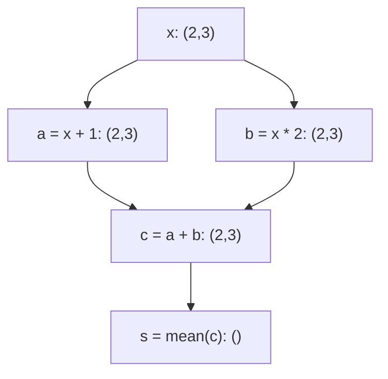

# Step 18 — MLX Execution Model

沿用既有roadmap，本轮只准备并发布 **18.1 Lazy evaluation**，初始实际修正计数 **0/2**；完成即停，不进入18.2。母版：[77_step18_1_lazy_evaluation.ipynb](../notebooks/77_step18_1_lazy_evaluation.ipynb)。

材料审核方已独立核验17.5五文件提交 `3fdec00b251765bda581c2b183e68d039c83c902`、固定MLX v0.32.2接口及完整教学回复，核心静态PASS、修正0/2；大Step17全部材料通过。这是材料验收，不是学员掌握或运行反馈。18.1当前只登记初始材料编写发布，不能继承前节的外部验收结论。

## Step 18.1 — Lazy evaluation

本节承接17.5显式求值边界，解释数组运算怎样建立计算依赖，以及为什么Python走过一行不等于对应GPU数值工作已完成。全部示例代码仅为材料，未执行、无运行输出。


### 0. 新Work Copy的依赖：只有MLX与本节常量

沿用项目 Python 3.12 / `.venv` kernel，以及 `pyproject.toml` 固定的 `mlx==0.32.2`。`import mlx.core as mx` 导入MLX数组模块，`as mx` 给它一个短名称。

新副本完整提供导入、一个2行3列的常量数组、全部中间运算，以及后文的普通Python函数。不需要旧kernel变量、`%run`旧Notebook、语料缓存、sampler、MiniGPT类、`nn.value_and_grad`或Adam对象；17.5的单步只作为已解释过的接口背景。

以后使用时，从本节导入单元开始按顺序使用即可。当前准备阶段只写这些单元，不执行它们。

```python
import mlx.core as mx

# Self-contained lesson import. All cells in this master are unexecuted.
```

### 1. Lazy Evaluation：先表达依赖，再在需要时取得数值

**Evaluation（求值）** 在这里指取得数组运算的数值结果，不是用验证集评估模型。**Lazy evaluation（惰性求值）** 允许数组运算先描述“这个结果应由哪些输入、通过什么运算产生”，在需要结果值时完成相应的数值工作。

先区分四个相互关联的东西：

| 名称 | 本节含义 |
|---|---|
| **Array object，数组对象** | Python变量可以持有的MLX对象；它可以表示已有数据，也可以表示尚待求值的运算结果 |
| **Metadata，元数据** | 描述数组的信息，例如shape和dtype，不是数组每个位置的具体值 |
| **Dependency，依赖** | 为得到一个结果，需要哪些输入数组，以及怎样对它们运算 |
| **Element values，元素数值** | 例如结果矩阵某个位置究竟是4还是7；读取这些值需要相应结果已经可用 |

看 `a = x + 1.0` 时，Python会执行右侧表达式，调用MLX的加法接口，并把返回的数组对象绑定给名字a。**Name binding（名称绑定）** 就是让变量名指向一个对象。这里调用、对象创建、shape/dtype推导、依赖记录等工作确实发生了；但返回一个数组对象，并不要求其所有元素的数值此时已经计算完成。

记录的依赖指向这次运算使用的数组对象，不是存下字符串 `x + 1.0`，以后再根据Python变量名查找输入。这个区别也解释了17.5中已建立的旧loss不会因为model后来换成新参数，就自动变为更新后的loss。

因此要分清：**Python已经处理完这次调用**，与**相应设备数值结果已经完成**。对交给GPU的数组工作，前者不能单独证明后者；有些数值工作可能尚未启动。也不能反过来把惰性求值说成“每一行都会立即异步启动一个GPU任务”。

惰性不表示整个程序什么都没做、也不表示零内存。例如从Python列表构造一个已有常量数组，需要处理这些已有数据。我们只把“记录运算关系”和“完成该运算的元素数值”区分开，不把所有MLX语句一概当作同一种行为。

固定版本依据：[v0.32.2 ops.cpp](https://github.com/ml-explore/mlx/blob/v0.32.2/mlx/ops.cpp)中的加法/乘法创建带有输入依赖的输出数组；[array.h](https://github.com/ml-explore/mlx/blob/v0.32.2/mlx/array.h)分别保存数组描述、依赖和结果可用状态。这里只用这些源码核对概念，不引入内部状态查询API。

### 2. 一个有两条分支的小例子：从矩阵到Scalar

本节的x是普通实数数组，shape为 `(2,3)`，意思是2行3列；这两个轴没有batch/token语义，x也不是MiniGPT的logits。s只是一个算术平均，不能把它叫作本节新增的语言模型loss。

先铺垫代码将用到的操作：

- `mx.array(..., dtype=mx.float32)`：从给定数据构造MLX数组，并明确使用32位浮点数。这里的嵌套Python列表每项是一行，不从外部取数据。
- **Elementwise operation（逐元素运算）**：对应位置分别运算。`x + 1.0` 给每个元素加1；`x * 2.0` 给每个元素乘2，`*`在这里不是矩阵乘法。
- **Scalar broadcasting（标量广播）**：把一个标量用于每个位置的运算。本例的shape仍为 `(2,3)`；这种数学语义不要求实际复制一整张常量矩阵。
- **Reduction（归约）**：把一组元素汇总为更少的结果。`mx.mean(c)` 在固定v0.32.2默认 `axis=None`、`keepdims=False`，对全部元素求平均且不保留被归约的维度，所以输出为scalar MLX array，shape `()`。

`None`在这个API中表示未指定某一条轴，因此使用全部轴；`False`表示不保留归约轴。本例用默认写法 `mx.mean(c)`，没有隐藏的按行平均或按列平均。

先给出明确的输入，再准备依赖关系：

```python
# EXPLICIT TOY CONSTANTS — prepared only, NOT executed.
x = mx.array(
    [[1.0, 2.0, 3.0],
     [4.0, 5.0, 6.0]],
    dtype=mx.float32,
)

# Shape (2, 3): two rows and three columns, with no token/batch meaning.
```

```python
# Build the relationships; do not display array values in this cell.
a = x + 1.0
b = x * 2.0
c = a + b
s = mx.mean(c)

# No bare array expression at the end: ordinary Notebook display can read values.
```

#### 手算的是数学结果，不是本轮的执行输出

用i表示行下标（0或1），j表示列下标（0、1或2）。例如 `x[i,j]` 指第i行第j列。上面的数学关系是：

$$
a_{ij}=x_{ij}+1,\qquad b_{ij}=2x_{ij},\qquad c_{ij}=a_{ij}+b_{ij}=3x_{ij}+1.
$$

双重求和表示把两行三列的六个位置全部相加：

$$
s=\frac{1}{6}\sum_{i=0}^{1}\sum_{j=0}^{2}c_{ij}.
$$

逐位置代入明确的x，可手算：

$$
a=\begin{bmatrix}2&3&4\\5&6&7\end{bmatrix},\qquad
b=\begin{bmatrix}2&4&6\\8&10&12\end{bmatrix},\qquad
c=\begin{bmatrix}4&7&10\\13&16&19\end{bmatrix}.
$$

$$
s=\frac{4+7+10+13+16+19}{6}=\frac{69}{6}=11.5.
$$

这些数值来自手工推导，不是运行输出，也不作为GPU完成工作的证据。代码中保留原来的两条分支，没有用手算的 `3*x+1` 偷换代码结构。

#### Compute Graph：箭头说明“依赖谁”

**Compute graph（计算图）** 是表达运算依赖关系的一种方式。图中的节点表示数组结果，箭头从输入指向依赖它的输出。本例x同时供给a与b，c需要两条分支的结果，s再汇总c：



同一关系也可直接读表；即使Notebook前端没有渲染上图，表格仍完整表达依赖：

| 结果 | 直接依赖 | 运算 | 输出shape |
|---|---|---|---|
| x | 本节已给定的常量 | 构造输入数组 | `(2,3)` |
| a | x、标量1 | 逐元素加法 | `(2,3)` |
| b | x、标量2 | 逐元素乘法 | `(2,3)` |
| c | a、b | 逐元素相加 | `(2,3)` |
| s | c | 全元素平均 | `()` |

图省略了标量常量等实现细节。它是**数学依赖示意**，不是GPU执行时间线，也不保证a与b真的并行执行。一个高级API可以由多个内部运算组成；一行Python、图中的一个逻辑节点、一个底层GPU计算任务不能简单画等号。本节不分析具体设备调度。

### 3. 为什么还没读取元素，就能知道Shape和Dtype？

**Shape（形状）** 描述各轴长度；**dtype（数据类型）** 描述元素按哪一种数值类型表示。它们属于metadata。

本例的shape可以沿规则推出：x已知为 `(2,3)`；标量广播不改变a/b的shape；同shape的a与b相加得到同shape的c；对全部六个元素求平均并移除归约轴，s就没有剩余轴。这个推理不需要先读出c里面的4、7、10等结果。

Python中的 **attribute（属性）** 用点号读取：`c.shape`、`c.dtype`，这两处不加括号。固定MLX版本把shape暴露为Python tuple，把dtype暴露为数据类型描述；这两个读取本身不要求c的元素值完成求值。`print(...)` 是Python的显示函数；下面传给它的是标签字符串、shape tuple和dtype，而不是MLX数组本身。

本例x/a/b/c的shape均为 `(2,3)`，s为 `()`，这些数组的dtype为float32。**`()`表示零个轴的标量数组，仍有一个元素，不是空数组，也不是已经转换好的Python float。** 已经能读取这个shape，不能推出该标量的值已经完成计算。

固定依据：[v0.32.2 array.h](https://github.com/ml-explore/mlx/blob/v0.32.2/mlx/array.h)的shape/dtype访问器，以及[Python array binding](https://github.com/ml-explore/mlx/blob/v0.32.2/python/src/array.cpp)。

```python
# Metadata access only. This cell has not been executed.
print("x metadata:", x.shape, x.dtype)
print("a metadata:", a.shape, a.dtype)
print("b metadata:", b.shape, b.dtype)
print("c metadata:", c.shape, c.dtype)
print("s metadata:", s.shape, s.dtype)

# These attributes describe results; they are not evidence of numerical completion.
```

### 4. 普通Python函数已经返回，也不自动证明数值完成

这与17.5使用普通Python函数并不矛盾。先恢复三个Python含义：

- `def build_score(arr):` 定义一个函数；定义时不会执行函数体。`arr`是形参，调用时接收传入的数组对象。
- `build_score(x)` 才是调用，Python会执行函数体中的语句。名字 `build_score` 是本节自定义名称，不是一个额外的MLX API。
- `return score` 把score所指的对象交还给调用者。本例返回MLX数组对象，不在return处自动把它转成Python数字。

下面只是把同一个两分支表达式放进普通函数。`left`、`right`、`combined`、`score`是函数内部的变量名，分别对应之前的a、b、c、s；传入同一个x，数学关系和shape不变。函数返回后，调用者将该数组对象绑定给 `score_from_function`。

在这个只用数组运算并返回数组的函数中，**函数体执行结束**与**结果元素的数值完成**仍是两件事。普通Python的return不是额外的求值请求。本例没有任何编译包装，也没有训练步骤。

```python
def build_score(arr):
    left = arr + 1.0
    right = arr * 2.0
    combined = left + right
    score = mx.mean(combined)
    return score


# One prepared ordinary function call; NOT executed during material preparation.
score_from_function = build_score(x)
print("returned metadata:", score_from_function.shape, score_from_function.dtype)

# Returning an MLX array does not itself request its element value.
```

### 5. 看描述与读取值不同：接回17.5的求值边界

有些操作需要真正的元素值。**Implicit evaluation（隐式求值）** 指代码没有单独写 `mx.eval`，但某个取值操作为了给出结果而要求数组求值。这里仅辨认最常见的显示/取值方式，不增加求值或性能实验。

| 阅读到的表达式 | 要取得什么 | 与本例求值的关系 |
|---|---|---|
| `s.shape`、`s.dtype` | 结果的描述 | 这两个属性访问本身不要求元素值 |
| `print(s)` | 数组的数值表示 | 会要求s完成相应求值，才能显示值 |
| Notebook单元末尾的裸表达式 `s` | 常规交互显示中的对象表示 | 通常也会读取数组数值；不能把它视为纯metadata检查 |
| `s.item()` | 单个元素转为标准Python scalar | 需要时会求值；本例float32标量会转为Python float |
| `mx.eval(s)` | 明确要求s及所需依赖完成 | 沿用17.5接口，返回None，不返回一个新s |

`array.item()`是数组对象上的 **method（方法）**，所以有括号；固定版本要求数组只有一个元素。本例s满足条件。这个接口已经在17.5日志显示中出现，这里只是说明它为什么不能当作不影响求值的“查看一下”。

这也解释了前面代码为什么只打印 `.shape`、`.dtype`，并避免把MLX数组单独留在单元格最后一行。以后看到数组已经被打印，不能据此反推“之前每个加法语句都立即完成了数值计算”；打印本身可能正是要求数值的操作。

上述表格是接口阅读材料，不是本节额外的执行单元。固定版本中，数组的数值显示路径会调用求值，见[Python array binding](https://github.com/ml-explore/mlx/blob/v0.32.2/python/src/array.cpp)与[utils.cpp](https://github.com/ml-explore/mlx/blob/v0.32.2/mlx/utils.cpp)；`.item()`的取值路径见[convert.cpp](https://github.com/ml-explore/mlx/blob/v0.32.2/python/src/convert.cpp)。

#### 17.5的边界现在更容易理解

17.5的 `loss_and_grad_fn(model, X, Y)` 建立forward、scalar loss和梯度的关系；`optimizer.update(model, grads)`继续用梯度建立新参数与新状态的关系，并把对象中的引用更新好。仅从这两次Python调用已经返回，不能推出所有相应的设备数值已经完成。

所以17.5接着使用 `mx.eval(loss_before_update, model.parameters(), optimizer.state)`，明确要求这些结果及其依赖完成。这个接口等待指定结果可用后返回None；它不是对所有无关GPU工作的全局完成承诺。

那一节的训练函数之所以在返回前有明确的完成要求，是因为它**在函数体中写了求值边界**，不是因为普通Python函数的return天然具有这种保证。18.1只解释这个原因，不重建模型、优化器或训练单步，也不展开18.2的边界安排、图增长和内存主题。

### 本节的工作副本顺序、材料状态与停止点

以后使用本节新work副本时：

1. 在仓库根目录先 `git pull`，再将77母版用时间戳新文件名及 `cp -n` 安全复制到已有 `notebooks/work/`；只打开新副本。
2. 选择项目Python3.12 / `.venv` kernel，从本节 `import mlx.core as mx` 开始；其后输入常量和全部定义都已在副本中。
3. 按次序阅读数组对象与依赖、常量与两分支运算、手算及shape，再使用仅读取metadata的示例；不需要先运行17.5。
4. 普通函数示例依赖的只有本节mx和x。末尾表格用于辨认取值操作，17.5边界仅作阅读衔接，不需要在77副本里补入任何model或optimizer变量。

本节贯穿的关系是：**已知数学表达式和shape，足以继续组织依赖；需要元素值时，才必须保证相应数值工作完成。** Python名称绑定、函数返回、metadata可读与GPU结果完成之间，不能仅凭其中一项替另外一项作结论。

大Step17的全部材料验收保留；本轮18.1只记初始材料编写发布。累计实际修正：16.1=**1/2**、16.2=**1/2**（含已记录的超时后完整回复补齐），16.3至16.5及17.1至17.5各**0/2**，18.1初始生成=**0/2**。每小节最多两次实际修正，跨轮与换对话不重置。

只编写发布材料，没有执行Notebook、课程代码、测试、训练、实验、采样或用户work副本，没有读取/下载语料，没有代答练习；不声称学员掌握、执行完成或运行验证通过。不返工已合格课节。

**完成后停在18.1，不进入18.2。** 后续仍仅按请求逐小节准备，至大Step20全部完成后停止。

### 参考与固定版本核对

- [17.5已验收母版](https://github.com/kris0516/mlx-minigpt-from-scratch/blob/3fdec00b251765bda581c2b183e68d039c83c902/notebooks/76_step17_5_uncompiled_training_step.ipynb)：未编译单步、scalar loss与显式求值边界。
- [MLX v0.32.2 ops.cpp](https://github.com/ml-explore/mlx/blob/v0.32.2/mlx/ops.cpp)：add/multiply创建运算依赖，mean的组合实现。
- [MLX v0.32.2 array.h](https://github.com/ml-explore/mlx/blob/v0.32.2/mlx/array.h)：数组描述、shape/dtype读取，以及数值可用状态的区分。
- [MLX v0.32.2 Python ops](https://github.com/ml-explore/mlx/blob/v0.32.2/python/src/ops.cpp)与[Python array](https://github.com/ml-explore/mlx/blob/v0.32.2/python/src/array.cpp)：mean默认轴/keepdims、属性、数值显示绑定。
- [MLX v0.32.2 utils.cpp](https://github.com/ml-explore/mlx/blob/v0.32.2/mlx/utils.cpp)与[convert.cpp](https://github.com/ml-explore/mlx/blob/v0.32.2/python/src/convert.cpp)：数组显示与item读取触发相应求值。
- [MLX v0.32.2 Python transforms](https://github.com/ml-explore/mlx/blob/v0.32.2/python/src/transforms.cpp)与[core transforms](https://github.com/ml-explore/mlx/blob/v0.32.2/mlx/transforms.cpp)：仅用于复核17.5已讲过的eval接口及等待语义。
- 官方API：[array.shape](https://ml-explore.github.io/mlx/build/html/python/_autosummary/mlx.core.array.shape.html)、[mean](https://ml-explore.github.io/mlx/build/html/python/_autosummary/mlx.core.mean.html)、[array.item](https://ml-explore.github.io/mlx/build/html/python/_autosummary/mlx.core.array.item.html)。在线页面可能更新，本课程接口与行为以 **v0.32.2源码** 为准。
- [Roadmap](https://github.com/kris0516/mlx-minigpt-from-scratch/blob/main/docs/course-roadmap.md)与[teaching handoff](https://github.com/kris0516/mlx-minigpt-from-scratch/blob/main/docs/teaching-handoff.md)：18.1当前材料状态、累计计数与停止边界。
